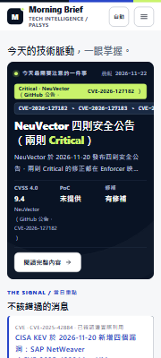
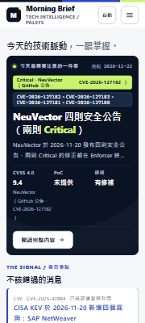
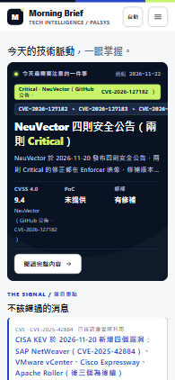
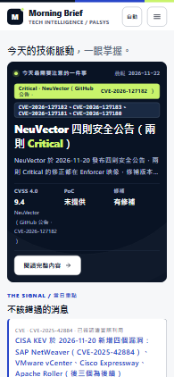
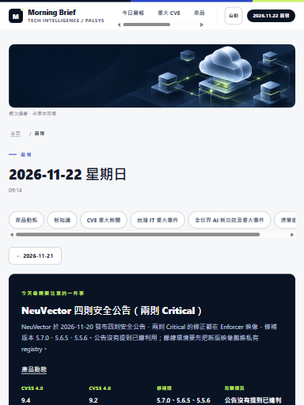
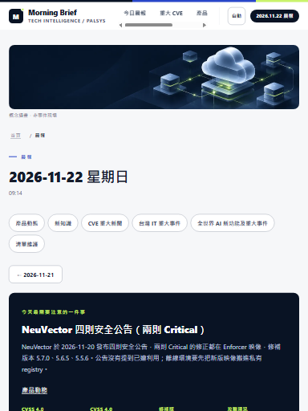
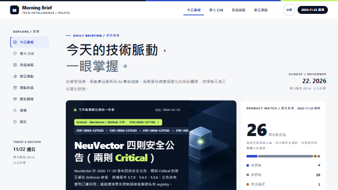
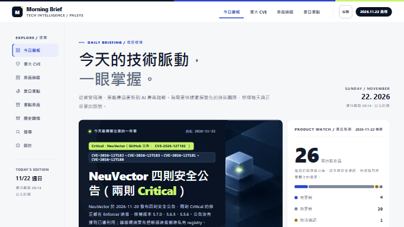

# 首頁 CVE 標籤與當日段落導覽換行修正

來源：archive main `ccf2cf5b9f85c1724444d54fb31f672696460003`（11/22 資料）。只修改 CSS 與此份驗證紀錄，不改文案或正式資料。

## 根因與修正

A：`.tag` 為 inline-flex，四個不斷行的 CVE span 與文字節點在同一 flex 列，總寬約 530.38px，超過 `.feature`，被其 overflow:hidden 裁掉。僅將 `.feature .tag--dark.tag--mono` 改成 block、max-width:100%、white-space:normal，讓編號之間自然換行；每個 `.cve-id` 保留既有 nowrap。

B：`.d14 .v4-jump` 覆寫原本 wrap 為 nowrap，並有 40px 假元素尾端留白。改回 wrap、移除其 overflow-x:auto 與尾端假元素；section-tabs 的捲動設定維持。每個導覽連結仍保留 nowrap 與 44px 最小高度。

## 量測環境

內建 Browser Chromium 158／Windows，亮色、同源 iframe；CSS viewport 為 360×800、390×844、768×1024、1366×768。iframe scrolling=no 讓有效 layout width 與指定寬相同，不注入產品 CSS；截圖僅將 iframe 外框 transform:scale(.5)，不改其 CSS viewport。先等字型載入，再等兩個 animation frames。使用本機預覽建置，不是真機或完整裝置模擬。

先重現並量測舊版，再修改；截圖保存的是原始畫面，無重畫文字。字型環境不同，先前轉述的 532/812 與本次 530.38/808 有些微差異；原問題均重現。

## 首頁 CVE 標籤

| CSS 寬度 | 標籤寬前→後 | 標籤 scrollWidth 前→後 | 卡片右界 | 標籤右界前→後 |
|---|---:|---:|---:|---:|
| 360 | 530.38 → 296.00 | 529 → 295 | 344.00 | 562.38 → 328.00 |
| 390 | 530.38 → 326.00 | 529 → 325 | 374.00 | 562.38 → 358.00 |
| 768 | 530.38 → 469.28 | 529 → 468 | 543.28 | 578.38 → 517.28 |
| 1366 | 530.38 → 428.47 | 529 → 427 | 762.27 | 830.18 → 728.27 |

四種寬度修正後的 4 個 CVE span 均完整位於標籤邊界內，每個編號仍為 nowrap。卡片自身 scrollWidth 包含既有裝飾性 ::before 圓形，不能當成文字裁切判斷；此修正以標籤和各 CVE 的實際邊界驗證。

## 當日段落導覽

| CSS 寬度 | clientWidth | scrollWidth 前→後 | 高度前→後 |
|---|---:|---:|---:|
| 360 | 328 | 808 → 328 | 67.33 → 156.00 |
| 390 | 358 | 808 → 358 | 67.33 → 156.00 |
| 768 | 724 | 808 → 724 | 67.33 → 104.00 |
| 1366 | 1104 | 1104 → 1104 | 52.00 → 52.00 |

四種寬度修正後的 6 個連結均在導覽邊界內，clientWidth=scrollWidth，連結高皆 44px。原始資料含完整子項文字與邊界，見 after-child-bounds.json。

## 建置與檢查

本機 Node v25.8.2。每行為獨立指令（在 repo 根目錄執行）：

```powershell
npm.cmd test
npm.cmd run check:contrast
npm.cmd run build -- --base-path /morning-brief-preview/ --visual-preview --output ../build-wrap-after
git diff --exit-code ccf2cf5b9f85c1724444d54fb31f672696460003 -- daily products items.jsonl state
```

實際結果：70 tests、70 pass、0 fail、0 skipped；CONTRAST OK: 42 pairs × 2 themes；BUILD OK: 61 HTML pages; 26/26 product pages; 5 daily editions; 87 search items; 0 warnings; mode=production。資料 diff 無輸出、exit 0。測試完整輸出見 tests.log；對比完整輸出見 contrast.log。建置輸出資料夾須為新空目錄，重跑請改用新路徑。

未新增鏡像 CSS 的單元測試；實際 Browser 檢查四種寬度的目標元素及所有子項邊界，未放寬既有測試。

## 前後截圖（原始畫面，50% 顯示比例）

### 首頁 360px

修正前：



修正後：



### 當日頁 360px

修正前：


修正後：


### 首頁 390px

修正前：



修正後：



### 當日頁 390px

修正前：


修正後：


### 首頁 768px

修正前：


修正後：


### 當日頁 768px

修正前：



修正後：



### 首頁 1366px

修正前：



修正後：



### 當日頁 1366px

修正前：


修正後：


## 未驗證

- 公開 PR CI 的執行結論及 job 日誌。
- 此 PR 的公開預覽部署；此次沒有更新 preview repo。
- 真實手機與完整裝置模擬。
- 深色模式與深色 chip 對比。
- Safari。
- Firefox。
- 螢幕閱讀器。
- 200% 縮放。
- 導覽連結點擊與鍵盤操作（本次只量測排版及邊界）。
- 獨立驗證及安全審查。

## 回復

本 PR 未合併且未部署。若後續已合併，應以新的 revert commit 走 PR 回復，不強制改寫 main；回復會恢復已知裁切，須評估。驗證指令：git diff <原基準> -- site/assets/site.css；預期回復後 CSS 與原基準相同。此次未執行回復。

## 依據

- [原始 CSS](https://github.com/george-palsys/morning-brief-archive/blob/ccf2cf5b9f85c1724444d54fb31f672696460003/site/assets/site.css)
- [CVE 不換行規則](https://github.com/george-palsys/morning-brief-archive/blob/ccf2cf5b9f85c1724444d54fb31f672696460003/site/assets/visuals/visual.css)
