# 手機首屏回歸與合併前守護修正

父版本：b8179ca70bd986657d9b6335c208dd2d5c9c39c7。資料基準 ccf2cf5。未修改 daily、products、items.jsonl、state；不合併、不部署、不強制改寫歷史。

## 修正

- ≤640px 當日段落導覽 min-height 44→32px、字級12px、水平內距12px、gap4px。維持換行與既有文案，不加元件。高度156→112px，保留全部連結；最小連結61.33×32px，均不小於本次要求24×24 CSS px。
- S6隱藏範圍由≤640改為≤1023，768px重複小字從42px高度降為display:none（0px），淺深相同；桌面規則不變。
- 清理既有3份日誌的工作區絕對路徑，替換為<workdir>/；包含終端自動折行的路徑。新增docs全檔遞迴掃描守護，禁止本機使用者路徑及應用程式資料夾識別字。
- 新增CLI測試：子程序以--base-path /morning-brief-preview/ --visual-preview建置，驗404的robots meta與報告boolean。另測正式workflow不得帶預覽旗標。
- contrast新增selected-border/wash，仍3:1，不調低任何門檻。

## 重大事件標題與導覽前後量測

| 視窗 | 主題 | 標題bottom前→後 | 導覽高度前→後 | 導覽clientWidth | scrollWidth前→後 | 最小連結寬×高（後） |
|---|---|---:|---:|---:|---:|---:|
| 360×800 | light | 822.95→778.95 | 156→112 | 328 | 328→328 | 61.33×32 |
| 360×800 | dark | 824.28→780.28 | 156→112 | 328 | 328→328 | 61.33×32 |
| 390×844 | light | 822.95→778.95 | 156→112 | 358 | 358→358 | 61.33×32 |
| 390×844 | dark | 824.28→780.28 | 156→112 | 358 | 358→358 | 61.33×32 |
| 768×1024 | light | 836.55→836.55 | 104→104 | 724 | 724→724 | 75.33×44 |
| 768×1024 | dark | 837.89→837.89 | 104→104 | 724 | 724→724 | 75.33×44 |
| 1366×768 | light | 746.92→746.92 | 52→52 | 1104 | 1104→1104 | 75.33×44 |
| 1366×768 | dark | 748.25→748.25 | 52→52 | 1104 | 1104→1104 | 75.33×44 |
| 1280×720 | light | 742.79→742.79 | 52→52 | 1018 | 1018→1018 | 75.33×44 |
| 1280×720 | dark | 744.13→744.13 | 52→52 | 1018 | 1018→1018 | 75.33×44 |

360px兩主題均≤800；深色780.28略超理想780，但滿足必要目標。390px餘裕由21.05/19.72px增加至65.05/63.72px。768與1366無退步；1280×720維持首屏外的已知限制。所有連結邊界完整位於導覽內，documentWidth等於指定寬，無整頁或導覽橫向溢位。

## 執行與驗證

本機Node v25.8.2，全部74 tests pass、0 fail、0 skipped。CONTRAST OK:46 pairs ×2 themes；wash檢查門檻3:1，淺色3.21:1。新CLI測試的正常執行成功。完整輸出見tests.log、contrast.log。

```powershell
npm.cmd test
npm.cmd run check:contrast
npm.cmd run build -- --base-path /morning-brief-preview/ --visual-preview --output ../build-guards-after
git diff --exit-code ccf2cf5 -- daily products items.jsonl state
```

建置實際61 HTML、26/26 product pages、5 daily editions、87 search items、0 warnings；資料diff無輸出exit0。建置重跑需新空輸出資料夾。新增docs守護測試掃描整個docs，包括新增log/json/png。

## CLI破壞驗證

暫時把CLI對--visual-preview的解析改為false，執行下面指令，得到exit1及CLI測試失敗（404缺robots）。隨後以原始bytes還原build.mjs，確認bytes相同，再重跑全部測試成功。沒有提交破壞版本。完整失敗輸出見cli-mutation.log。

```powershell
node --test --test-name-pattern="CLI preview flag" site/d14.test.mjs
```

預期破壞版本exit非0、原版exit0；實際相符。這是手動驗證紀錄，不是供正式環境執行的修改指令。

## 歷史路徑揭露

本次只清理新head的檔案。已推送ff0409a、b8179ca歷史仍含舊本機路徑，未force push或改寫歷史；是否squash merge由維護者決定。不要宣稱整段Git歷史已清理。

## Browser證據

內建Browser Chromium158／Windows，同源iframe；scrolling=no讓CSS layout width等於指定寬；等字型及兩個animation frames後量測。截圖外框縮放50%，內部layout未縮放。非手機真機或完整裝置模擬。初次本機頁面連線失敗，重啟本機靜態服務後恢復並完成以下實測。24張原始截圖：五視窗×淺深×前後當日頁，另768首頁淺深前後。

### daily 360 light


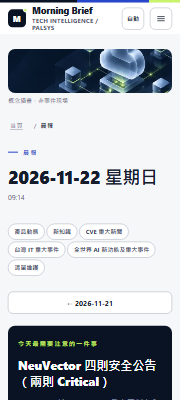

### daily 360 dark

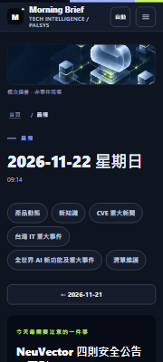

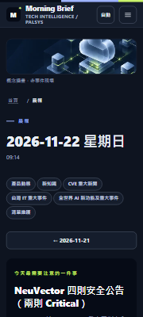

### daily 390 light


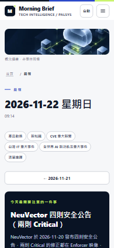

### daily 390 dark

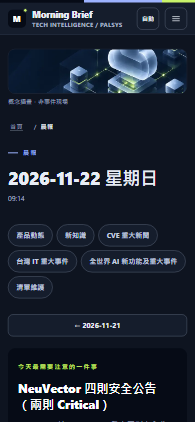

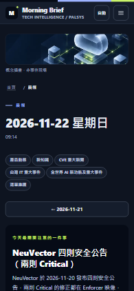

### daily 768 light

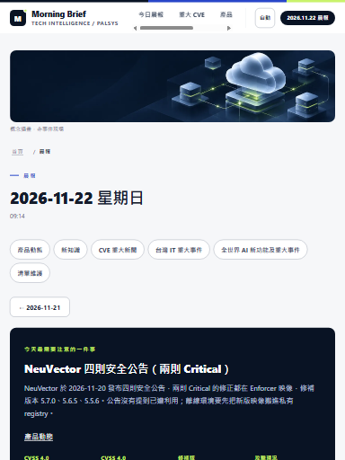


### daily 768 dark

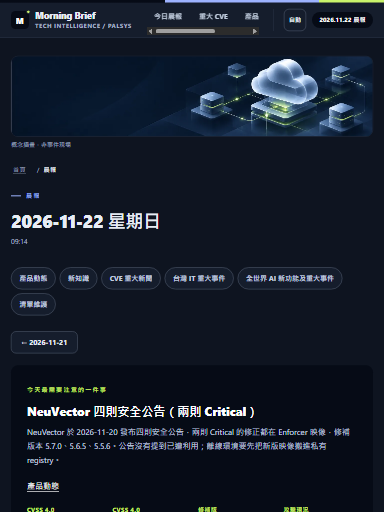


### home 768 light

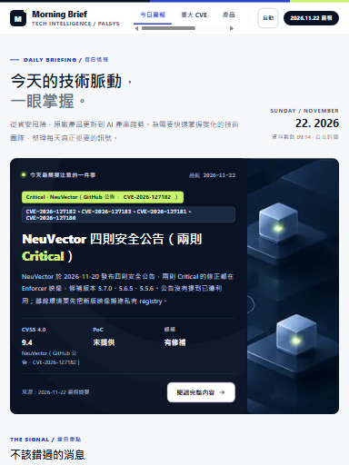

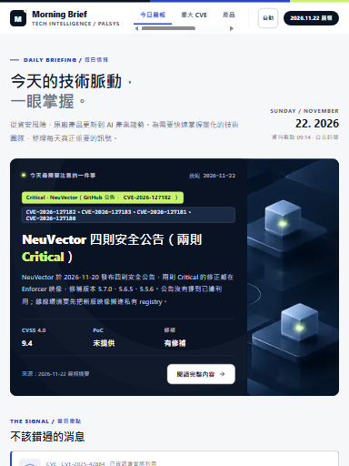

### home 768 dark

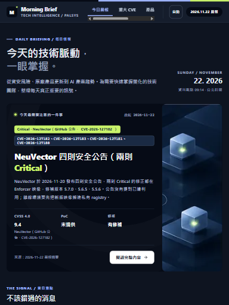

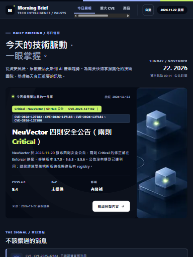

### daily 1366 light

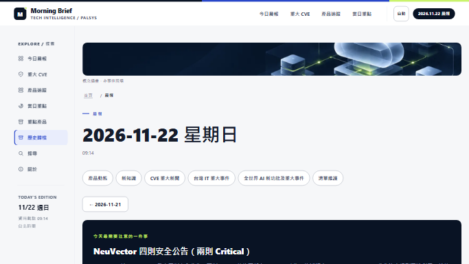


### daily 1366 dark

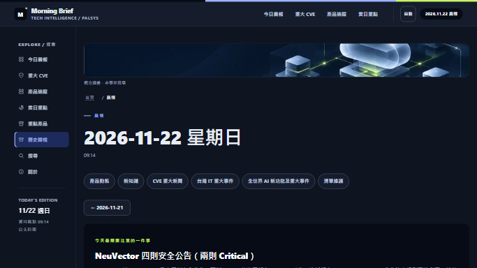


### daily 1280 light

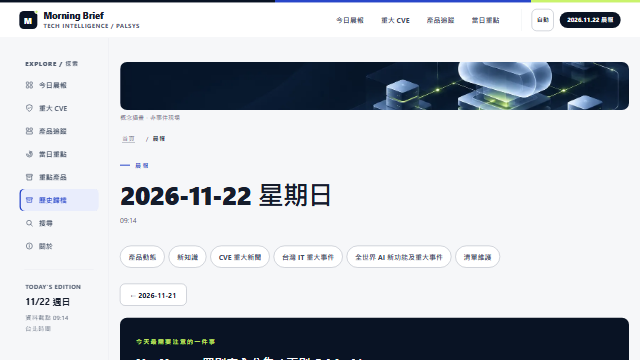


### daily 1280 dark


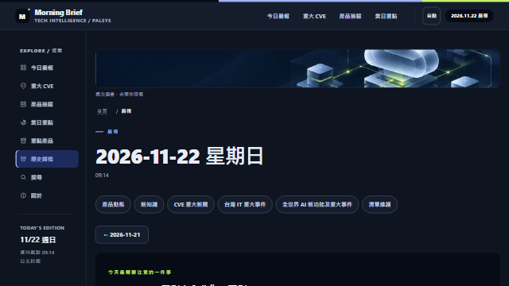

## 未驗證

- 新head的CI最終結果與job完整日誌（交付時查一次）。
- 公開部署。
- 手機真機與完整裝置模擬。
- Safari。
- Firefox。
- 螢幕閱讀器。
- 200%縮放。
- 鍵盤焦點及導航點擊。
- 系統深色實際切換（Browser使用手動theme）。
- 本輪獨立驗證與安全審查。

## 回復

本增量未合併或部署。需要時以新的revert commit走PR，避免force push；驗證git diff <父版本> -- site/assets/visuals/visual.css，預期回復後CSS相同。回復會恢復手機首屏回歸及路徑日誌問題，須先評估。未執行回復。
