# 首屏、深色選取狀態與索引防呆增量

父版本：ff0409a7e88f2f573ebb27d22782498147e66877；資料基準仍為 ccf2cf5b9f85c1724444d54fb31f672696460003。只追加 commit，不合併、不部署、不修改正式資料。

## 實作

- S1：≥1024px 的 .d14 .mb-banner img max-height:96px，banner margin-bottom:8px。
- S2：手動與系統深色的 selected-bg、selected-ink、selected-border 改為 #9db3ff、#0e1420、#9db3ff。已選 aria-pressed chip 增加 content:"✓" / ""，aria-pressed 本身不變。
- S6：≤640px 的首頁 facts dd small 隱藏；768 與1366 保留。
- S4 跳過：v4-jump 已換行，四種寬度 clientWidth=scrollWidth，不需右緣捲動淡出；未新增 tabs-scroll mask，也未驗證 mask 的 Safari 或焦點行為。
- 未實作新聞標題連結、新 border token、側欄 active 與首屏第一則新聞。
- L1：d14.test.mjs 新增單一防呆案例，以 visualPreview false、true 各建置所有頁面，每一頁檢查 robots meta（包含 404），並檢查報告中的實際 boolean。build-report.json 新增 visualPreview。

## 首屏量測

| 寬×高 | 主題 | 標題 bottom 前→後 | 修正後在首屏 |
|---|---|---:|---|
| 1366×768 | light | 818.92 → 746.92 | 是 |
| 1366×768 | dark | 820.25 → 748.25 | 是 |
| 1280×720 | light | 814.79 → 742.79 | 否 |
| 1280×720 | dark | 816.13 → 744.13 | 否 |

1280×720 仍在首屏外，未再壓縮版面。1366 的橫幅截圖仍可看見雲端主體。

## 深色對比：Browser computed styles

| 項目 | 前 | 後 |
|---|---:|---:|
| 已選文字對填色 | 6.65:1 | 9.06:1 |
| 未選文字對填色 | 10.71:1 | 10.71:1 |
| 已選／未選填色差 | 1.25:1 | 8.30:1 |
| 已選／未選外框差 | 1.79:1 | 1.79:1 |
| 已選／未選文字差 | 1.29:1 | 11.69:1 |
| 已選外框對未選背景 | 8.30:1 | 8.30:1 |
| 未選外框對未選背景 | 4.64:1 | 4.64:1 |
| section-tabs aria-current=page 文字 | 6.65:1 | 9.06:1 |
| chip aria-current=true 文字（探針） | 6.65:1 | 9.06:1 |

已選底/框 #9db3ff、字 #0e1420；未選底 #151d2c、框 #7a879b、字 #c3cfe0。淺色已選文字對比維持17.03:1；兩主題均看到 ✓。四種寬度均檢查；section-tabs 使用實際 CVE 頁的 aria-current=page。現有頁面沒有 chip aria-current=true，因此在驗證時複製既有 chip、改該屬性並暫時插入同一文件量測，隨即移除；這是樣式探針，不代表產品存在該狀態。

## 對比測試變更說明

第一次 contrast 檢查失敗，因指定新配色讓外框與自身填色相同，舊 selected-border/selected-bg 測試為1:1。保留初次失敗輸出 contrast-initial-failure.log。未降低任何門檻：文字仍4.5:1，邊界／狀態仍3:1。將「外框對自身填色」改成外框對 paper、canvas，並新增 selected-bg 對 paper、canvas，檢查實心控制的周圍邊界與已選／未選差異。檢查由42組增至45組，手動與系統深色 token 相同的斷言保留。此項是檢查對象調整，明列供審查，非略過失敗。

## 建置程式與正式產物 bytes

對 ccf2cf5 的完整正式建置比較，只有4檔不同：assets/site.css（前次 A/B）、assets/design-tokens.css（S2）、assets/visuals/visual.css（S1/S2/S6）、build-report.json（visualPreview:false）。其他檔案包含61頁HTML皆逐位元相同。

另外以相同新 CSS、原 ccf2cf5 的建置程式作隔離對照，只有 build-report.json 不同；新增 visualPreview:false 後其餘 JSON 結構完全相同。故不能宣稱完整產物 byte 不變；建置程式的唯一正式輸出變化為要求新增的報告欄位，HTML 及其他資產不受建置程式修改影響。原始比較見 polish-byte-check.json。

## 實際執行與預期

在 repo 根目錄：

```powershell
npm.cmd test
npm.cmd run check:contrast
npm.cmd run build -- --base-path /morning-brief-preview/ --visual-preview --output ../build-polish-after
npm.cmd run build -- --base-path /morning-brief-archive/ --output ../build-polish-production
git diff --exit-code ccf2cf5b9f85c1724444d54fb31f672696460003 -- daily products items.jsonl state
```

本機 Node v25.8.2。結果：71 tests、71 pass、0 fail、0 skipped；CONTRAST OK:45 pairs ×2 themes；預覽及正式建置均61 HTML、26/26 product pages、5 daily editions、87 search items、0 warnings；資料 diff 無輸出、exit0。完整輸出見 tests.log、contrast.log。預覽61/61頁含noindex,nofollow，報告visualPreview=true；正式0/61頁含noindex，報告false。重跑建置須用新的空輸出資料夾。

## 量測與截圖限制

Chromium158／Windows，內建 Browser 同源 iframe；scrolling=no，實際CSS viewport為指定寬高。等字型與兩次animation frames後量測；截圖僅外框縮放50%，未改內部layout。產品頁捲至篩選器前120px，避免固定頁首蓋住已選晶片。首頁、當日頁維持scrollY=0。非真機、非完整裝置模擬。

52張原始前後截圖包含360×800、390×844、768×1024、1366×768，首頁／當日／產品各淺深；另有1280×720當日淺深。

## 原始截圖

### home 360 light

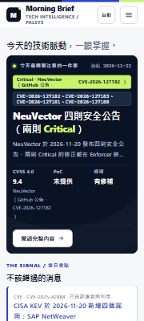

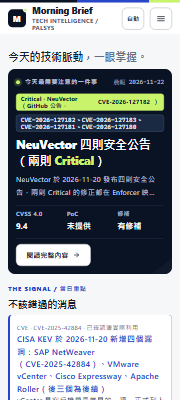

### home 360 dark

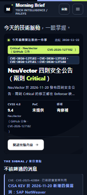

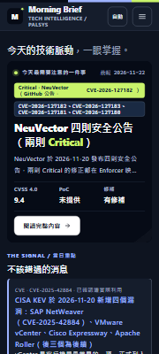

### daily 360 light

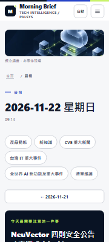


### daily 360 dark

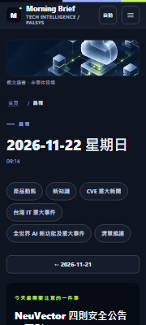


### products 360 light

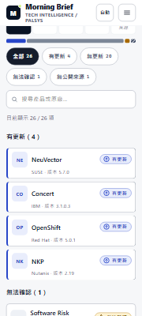

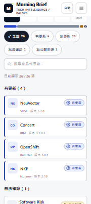

### products 360 dark

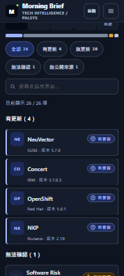

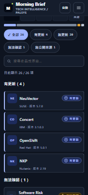

### home 390 light

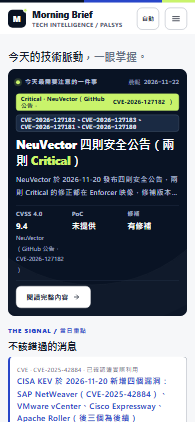

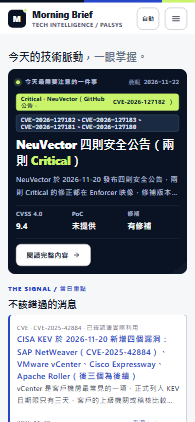

### home 390 dark

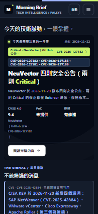

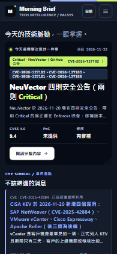

### daily 390 light

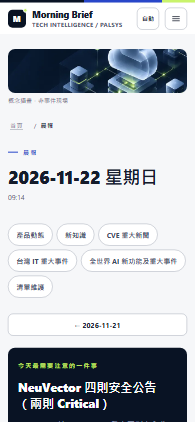


### daily 390 dark

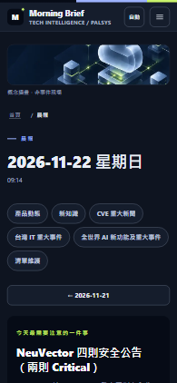


### products 390 light

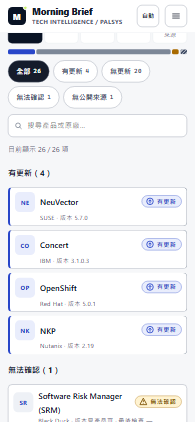

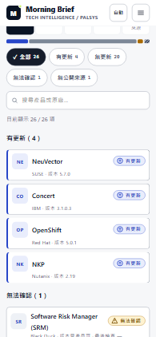

### products 390 dark

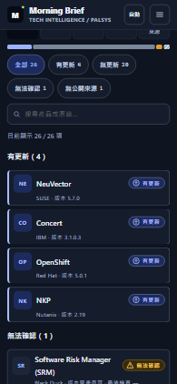

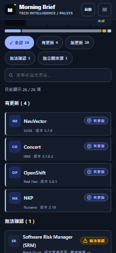

### home 768 light

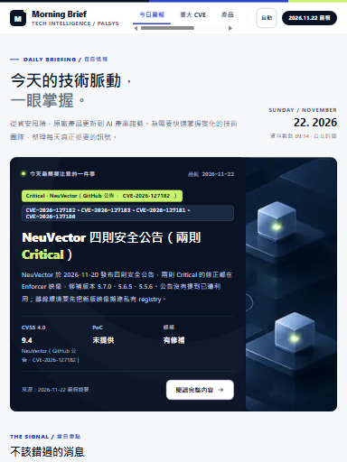


### home 768 dark

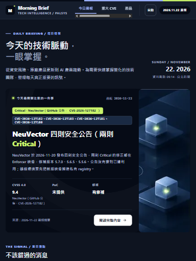


### daily 768 light

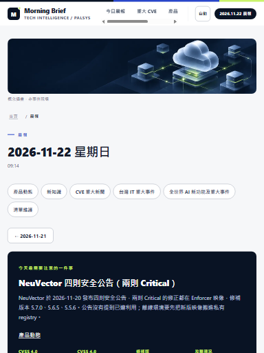


### daily 768 dark


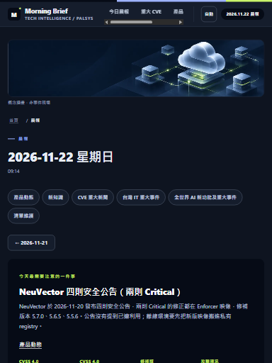

### products 768 light

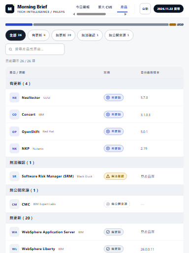

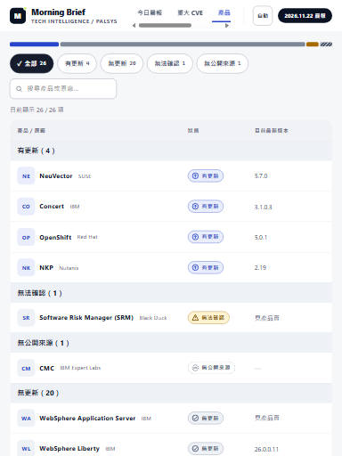

### products 768 dark

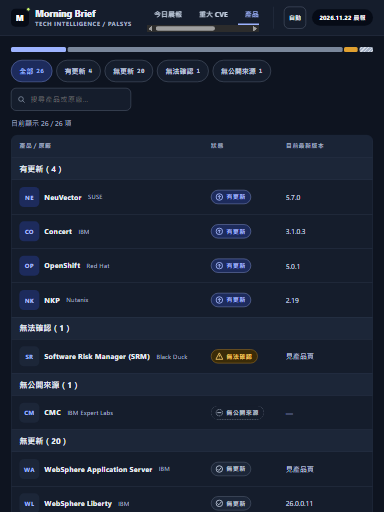

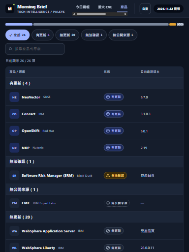

### home 1366 light

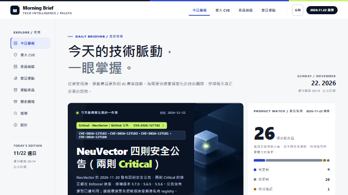


### home 1366 dark


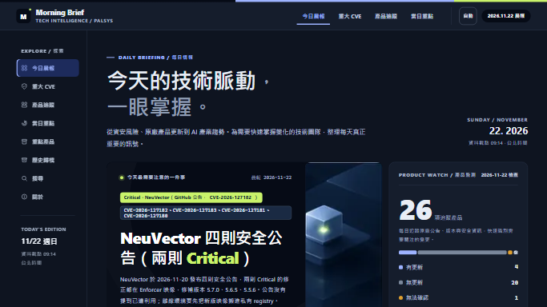

### daily 1366 light

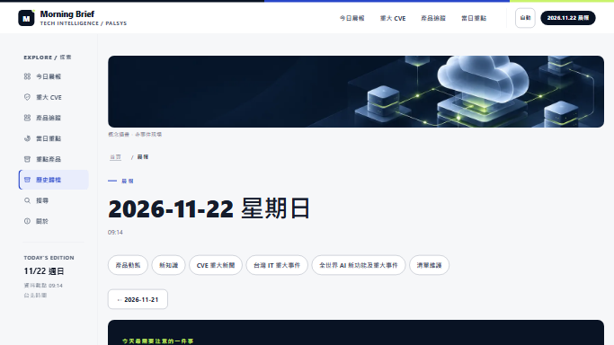

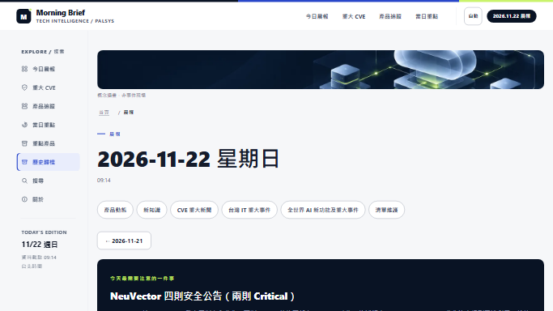

### daily 1366 dark

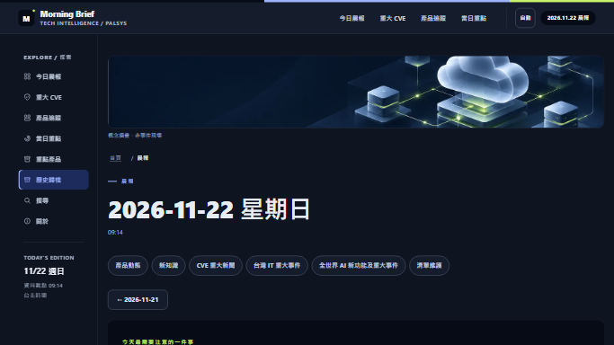

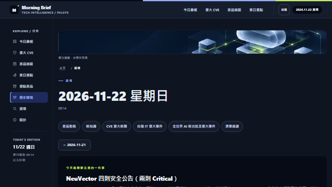

### products 1366 light

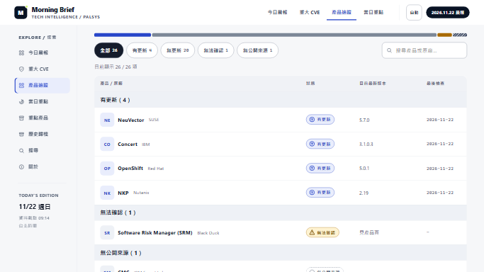

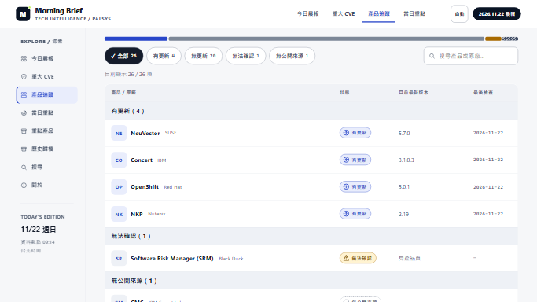

### products 1366 dark

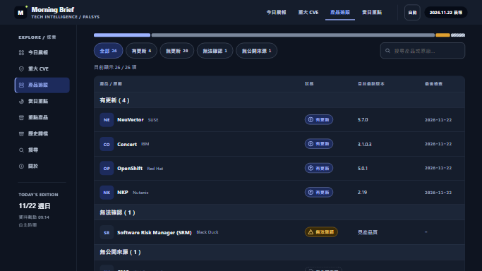

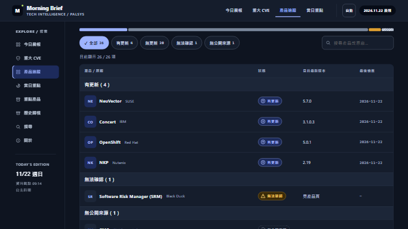

### daily 1280 light

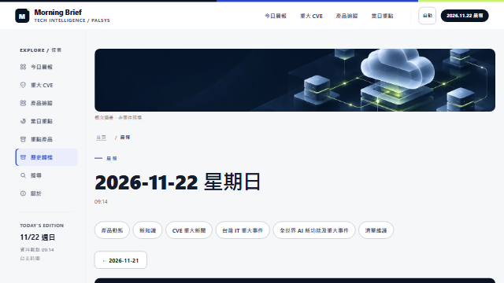

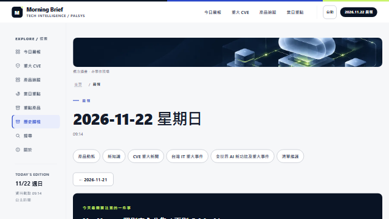

### daily 1280 dark

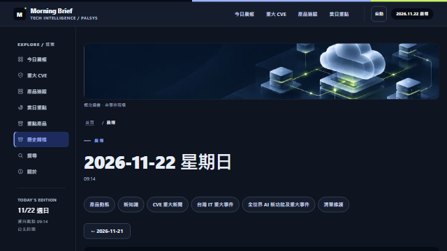

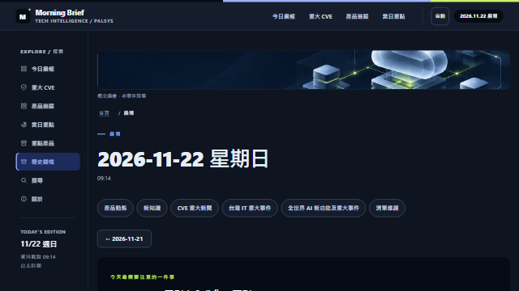

## 未驗證

- PR新head的CI最終結果及job日誌，交付時另讀回一次。
- 公開預覽與正式部署（本輪未部署）。
- 真實手機與完整裝置模擬。
- Safari。
- Firefox。
- 螢幕閱讀器及CSS content替代文字的實際朗讀。
- 舊瀏覽器不支援content替代文字語法時的降級。
- 系統深色媒體查詢的瀏覽器實際切換（兩組token相同由測試驗證；Browser使用手動theme）。
- 200%縮放。
- 鍵盤焦點、導覽點擊及產品篩選互動回歸。
- 獨立驗證與安全審查。

## 回復

尚未合併或部署。若後續需回復，對本增量commit建立revert並走PR，不強制改寫分支；驗證git diff <父版本> -- site/assets/visuals/visual.css site/assets/design-tokens.css site/build.mjs，預期回復後一致。未執行回復。
